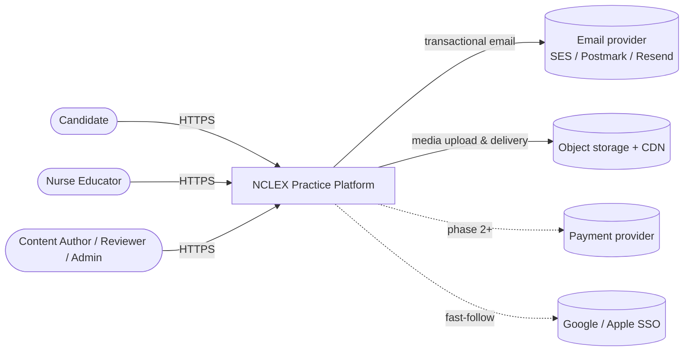
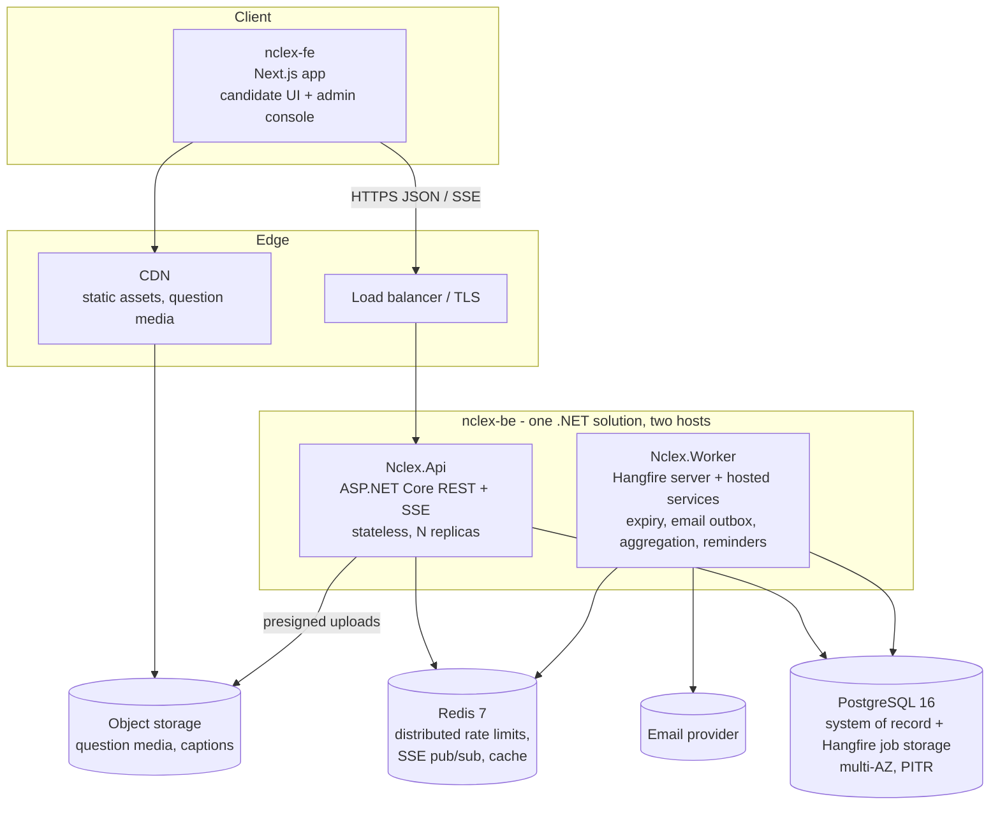
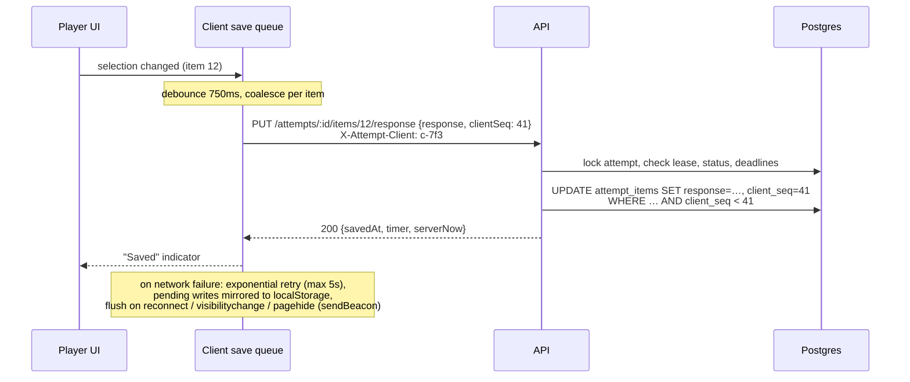
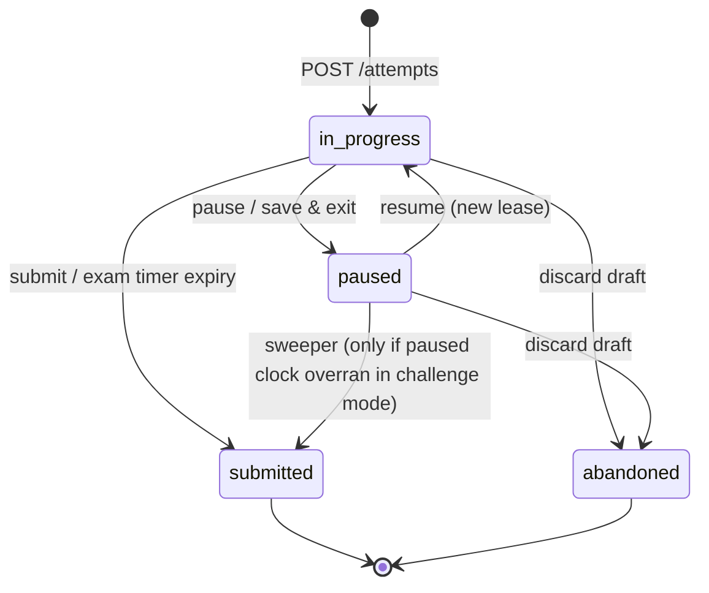
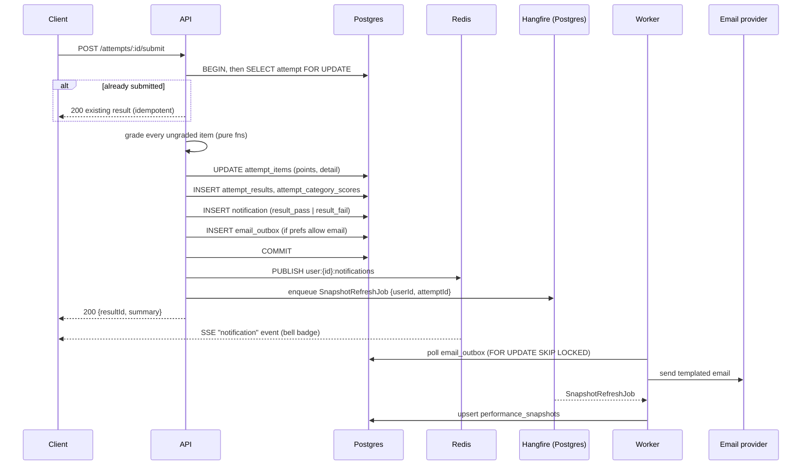

# System Architecture

## 1. Goals that shape the architecture

The design is built around these PRD requirements:

| Requirement | Architectural consequence |
|---|---|
| Timers must be server-authoritative and survive lost connections (§8) | Timer state lives in Postgres as *deadlines*, not counters. The server enforces expiry with three independent mechanisms (§5.1). |
| Autosave loses at most a few seconds (§5.3, §8) | Each answer change is written to the server with a debounce. The client keeps a retrying write queue. Writes are idempotent. |
| Pause/resume across devices (§5.4) | All attempt state is server-side. A single-device "lease" prevents two tabs from overwriting each other. |
| Answer keys and rationales must not leak before reveal (§5.1 Tutor/Exam mode) | Content, answer key and rationale are stored in **separate columns**. Candidate endpoints never select the key or rationale until the reveal rules allow it. |
| 18 NGN item types, grading rules 0/1, +/−, Rationale (§2.6, §2.7) | Each item type is a pluggable module: a JSON payload contract, a validator, a pure grading function and a renderer. |
| Result notification "within seconds" (§7.5) | Grading runs synchronously when the attempt is submitted. The notification and the email outbox row are written in the same transaction. Delivery is pushed over SSE. |
| Content changes must not alter past results | Questions are **versioned**. Attempts reference an immutable `question_version`. |
| 99.9% availability (§8) | Stateless API behind a load balancer, multi-AZ Postgres. Redis is treated as rebuildable, so Postgres is the only source of truth. |

## 2. System context



## 3. Containers



**Why a modular monolith.** There is one product team, one domain and strongly transactional workflows: grading writes results, the category breakdown, a notification and an email outbox row together. Microservices would add network failure modes to exactly the paths that must not fail. The modules below have clear boundaries, so the codebase can be split later if it ever needs to be.

**Why two hosts.** Request latency is kept separate from background work: emails, snapshot aggregation, expiry sweeps and reminders. Both hosts reference the same class libraries, so domain logic is written once.

**Why Hangfire on Postgres for jobs.** It supports delayed jobs (timer expiry), recurring jobs (sweeper, reminders) and retries, and it stores jobs in the same Postgres database. Jobs therefore survive a Redis outage, and Redis only holds things that can be rebuilt.

## 4. Backend structure (`nclex-be`)

Stack: **.NET 10 (LTS)**, **ASP.NET Core** (controllers), **EF Core 10 + Npgsql**, **Hangfire** (PostgreSQL storage), **StackExchange.Redis**, **FluentValidation**, **Serilog + OpenTelemetry**, **xUnit + Testcontainers**.

```
nclex-be/
  NclexPractice.sln
  src/
    Nclex.Domain/              no dependencies; pure C#
      Entities/                User, Question, QuestionVersion, TestSet, Attempt, AttemptItem, ...
      ItemTypes/               one folder per item type: payload records, validator, grader
        MultipleChoice/  Sata/  SelectN/  Matrix/  Dropdown/  Highlight/  Calc/  Ordered/ ...
        ItemTypeRegistry.cs
      Timing/                  AttemptTimer (deadline/remaining maths, pause-overrun rule)
      Scoring/                 ReadinessPolicy, category aggregation
    Nclex.Application/         use cases, by feature (vertical slices)
      Auth/  Users/  Taxonomy/  Content/  Banks/  TestSets/  Attempts/
      Grading/  Analytics/  Notifications/  Flags/  Admin/
      Abstractions/            IAppDbContext, IEmailOutbox, INotificationBus, IJobScheduler, IMediaStorage
    Nclex.Infrastructure/
      Persistence/             AppDbContext, EF configurations, migrations, raw SQL for hot paths
      Jobs/                    Hangfire job classes (AttemptExpiryJob, ExpirySweeperJob, DraftReminderJob, SnapshotRefreshJob)
      Messaging/               Redis pub/sub for SSE fan-out
      Email/                   provider client + templates
      Storage/                 S3 presigned URLs
      Security/                Argon2id hasher, JWT issuer, refresh token service, rate-limit store
    Nclex.Api/                 ASP.NET Core host
      Controllers/             one per resource group (Auth, Me, Attempts, TestSets, Notifications, Admin*)
      Sse/                     notifications stream endpoint
      Auth/                    JWT bearer setup, authorization policies (Role, VerifiedEmail, PlanTier, AttemptOwner)
      Middleware/              ProblemDetails mapping, request id, attempt-lease header
    Nclex.Worker/              Generic Host: Hangfire server + EmailOutboxDispatcher (BackgroundService)
  tests/
    Nclex.Domain.Tests/        grader golden fixtures, timer maths
    Nclex.Application.Tests/
    Nclex.Api.IntegrationTests/  WebApplicationFactory + Testcontainers (Postgres, Redis)
```

Dependency rule: `Domain` ← `Application` ← `Infrastructure` / `Api` / `Worker`. Item types and graders live in `Domain` and are pure functions over immutable records. This keeps graders unit-testable in isolation, and they carry most of the correctness risk. Inside `Application`, `Attempts` and `Grading` depend on `Domain.ItemTypes`. `Grading` also calls `Analytics` and `Notifications` through interfaces.

Key library choices:

| Need | Choice |
|---|---|
| ORM / migrations | EF Core 10 + Npgsql. Postgres enums mapped with `MapEnum`. JSONB columns as `JsonDocument` or `ToJson()` owned types. |
| Hot paths (autosave, builder pool) | Raw SQL through EF `SqlQuery` / `ExecuteSql`, or Dapper on the same connection |
| Background jobs | Hangfire with `Hangfire.PostgreSql`. Hangfire's minimum interval is one minute, so the email outbox uses its own `BackgroundService` polling every 2 seconds instead. |
| Validation | FluentValidation for request DTOs. Item payloads are checked by each item type's own validator. |
| Auth | `Microsoft.AspNetCore.Authentication.JwtBearer`, custom refresh-token service, Argon2id (`Konscious.Security.Cryptography.Argon2`) |
| Rate limiting | ASP.NET Core rate-limiting middleware, partitioned by IP and email, backed by Redis so limits apply across replicas |
| Errors | `ProblemDetails` (RFC 7807) through `IExceptionHandler` |
| OpenAPI | `Microsoft.AspNetCore.OpenApi` (built-in) → `/api/v1/openapi.json` |
| SSE | `TypedResults.ServerSentEvents` (.NET 10) fed by a Redis subscription |
| Time | `TimeProvider` injected everywhere, so timer tests can fake the clock |

## 5. Key designs

### 5.1 Server-authoritative timers

Timers are stored as **deadlines while running** and **remaining milliseconds while paused**. The server never counts down; it only compares `now()` with a deadline.

| State | `exam_deadline_at` | `exam_remaining_ms` |
|---|---|---|
| running | `now + remaining` | value at last transition (informational) |
| paused | `NULL` | authoritative remaining time |
| untimed | `NULL` | `NULL` |

The same pair exists per item (`item_deadline_at`, `item_remaining_ms`) for per-question timers. It starts when the candidate navigates to an item and freezes when they leave it or pause.

**Expiry is enforced three ways.** Any one of them is enough on its own.

1. **On every write.** Each attempt mutation runs inside `SELECT … FOR UPDATE` on the attempt row. If `now > deadline + 2s grace`, the write is rejected with `409 ATTEMPT_TIME_EXPIRED` and the attempt is finalized in the same request.
2. **Delayed job.** Every time a timer starts or resumes, the server schedules a Hangfire job, `BackgroundJob.Schedule<AttemptExpiryJob>(j => j.Run(attemptId, timerEpoch), deadline)`. Pause and resume increment `timer_epoch`, so stale jobs become no-ops.
3. **Sweeper cron (every 60s).** It finalizes `status='in_progress' AND exam_deadline_at < now() - interval '30 s'`. It's a Hangfire recurring job and covers any delayed job that was missed or failed.

When an item timer expires, that item is locked with its current response, as PRD §5.2 requires. When the exam timer expires, the whole attempt is auto-submitted and unanswered items are graded as blank (the R.O.O.T. behaviour).

**Client display.** Every attempt response includes `serverNow` and the timer block. The client computes `offset = serverNow - Date.now()` and renders `deadline - (Date.now() + offset)`, so a wrong local clock can't change the time limit.

**Pause limits (challenge mode).** `settings.pause = {maxPauses, maxPauseSec}`. On pause the server records `pause_started_at`. On resume:
`remaining = remaining_at_pause - max(0, (now - pause_started_at) - maxPauseSec*1000)`.
Overrunning a break therefore consumes exam time, as at a real testing centre, and no background job is needed. Practice mode uses `maxPauses = null`, which means unlimited.

### 5.2 Autosave and cross-device continuity



- **Idempotent and ordered.** Every client session has a monotonic `clientSeq`. A write with a stale sequence number is ignored and returns `200` with the current state.
- **Single active device (lease).** Opening an attempt calls `POST /attempts/:id/open` with a fresh `clientId`, which becomes `attempts.active_client_id`. Writes from any other client return `409 ATTEMPT_OPENED_ELSEWHERE`, and the UI offers "Continue here", which re-opens the attempt and takes over the lease. This is what makes desktop → mobile handoff safe.
- **Time spent per item is server-derived.** It's computed from navigation timestamps minus paused intervals, never sent by the client. This satisfies §5.2 time-per-item analytics without trusting the client.

### 5.3 Attempt lifecycle



A **draft** is any attempt with status `in_progress` or `paused`. "Save & Exit" is a pause with `reason='save_exit'`. Drafts never expire automatically. When `last_activity_at` is more than 30 days old, the dashboard shows a "resume or discard?" prompt (PRD §5.3), and the reminder job sends a `draft_reminder` notification after N days of inactivity (configurable, default 3).

### 5.4 Item-type plug-in model

Every item type is a module implementing one interface (full contract in [interfaces.md](interfaces.md#2-item-type-contracts)):

```
Nclex.Domain/ItemTypes/<Type>/
  <Type>Payloads.cs   records: Content, AnswerKey, Response (System.Text.Json)
  <Type>Module.cs     implements IItemTypeModule: ValidateAuthoring, ValidateResponse, MaxPoints, Grade, Present
Nclex.Domain.Tests/ItemTypes/<Type>/
  fixtures/*.json     golden test cases, including the PRD scoring examples
```

- Content is validated when an author saves a draft, so invalid items can't be published.
- Responses are validated on autosave against the item's content (option IDs must exist, a Select-N response can't exceed N, and so on).
- Graders are pure and deterministic. They are unit-tested with tables of `(key, response) → points`.
- Graders run **only on the server**. The frontend has a renderer per type but never sees the key before the reveal.
- **Trend, chart/exhibit, audio, video and graphic-option items are not separate types.** They are any base item type plus `exhibits[]` (a flowsheet, chart, media) or options with `mediaId`. This matches the PRD's note that trend scoring "depends on underlying item type".

MVP types: `multiple_choice`, `sata`, `select_n`, `matrix_mc`, `matrix_mr`, `multiple_response_grouping`, `dropdown_cloze`, `dropdown_table`, `highlight_text`, `highlight_table`, `fill_blank_calc`, `ordered_response`.
Phase 2: `drag_drop_cloze`, `drag_drop_rationale`, `dropdown_rationale`, `bowtie`, `hotspot`.

### 5.5 Grading, results and notification pipeline



- **Tutor mode** grades each item when the candidate submits it, which locks the item and returns the rationale. The final submit grades only the items that are still ungraded.
- **Exam mode** grades everything at final submit. Rationales are revealed only after that.
- **Category breakdown** is computed per dimension (`client_needs` at category and subcategory level, `body_system`, `item_type`, `cjmm_skill`) and stored in `attempt_category_scores`, so the results page is a single indexed read.
- **Readiness** (`passed`, `readiness_label`) is set only when the set has a `pass_threshold`. The UI always shows it with an "estimate, not a prediction of the real exam" caveat.
- **Transactional outbox.** The email is written in the same transaction as the result, so a crash can never produce a result without its notification, or an email without a result.

### 5.6 Notifications

- Stored per user in `notifications`, with read state.
- **Real-time delivery:** the client opens an SSE stream (`GET /notifications/stream`). API replicas subscribe to the Redis channel `user:{id}:notifications`, so any replica can deliver to any client. If the stream drops, the client falls back to polling `unread-count` every 60 seconds.
- **Channels:** `notification_preferences(user, category) → {in_app, email}`. Defaults: results and security go to both channels, everything else is in-app only.
- **Producers:** grading (results), the reminder cron (drafts, streaks), flag resolution (content admin action), and auth (security events).

### 5.7 Custom test builder

`POST /test-sets/custom` with filters (categories, systems, item types, difficulty, count, "unused/incorrect only"):

1. It builds a candidate pool in SQL: published questions on the user's track and tier, filtered by tags, and optionally excluding questions already answered (`user_question_history`).
2. It samples proportionally to the NCLEX test-plan weights when more than one category is selected, then fills any shortfall at random. Case-study items are kept together as a block of 6.
3. It persists a `test_sets` row (`kind='custom'`, `owner_user_id`) and its `test_set_items`, then immediately starts an attempt.

`GET /test-sets/custom/available-count` gives live counts while the user adjusts the filters.

### 5.8 CAT adaptive mode (Phase 2, designed now)

The schema already supports it: `attempt_items` rows are appended one at a time instead of being created up front, and `attempts.cat_state` holds `{theta, se, administered, contentCounts}`.

- **Model:** Rasch (1PL) using `question_versions.irt_b`. Until real calibration data exists, it's seeded from difficulty tiers (easy = −1, moderate = 0, difficult = +1).
- **Selection:** maximum information at the current θ, constrained by test-plan content balancing, with randomesque exposure control (pick from the top 5).
- **Stopping:** the 95% confidence interval excludes the passing standard (after the minimum number of items), or the item maximum is reached, or time runs out (the R.O.O.T. rule). The minimum and maximum are configurable per set and default to 85/150.

## 6. Security

| Concern | Design |
|---|---|
| Passwords | argon2id (memory 64 MB, t=3), minimum length 10, checked against a breached-password list. |
| Sessions | Access token: a JWT valid for 15 minutes, sent in the `Authorization` header. Refresh token: an opaque 256-bit value, stored hashed, sent as an `HttpOnly; Secure; SameSite=Strict; Path=/api/v1/auth` cookie. It is rotated on every use, and reuse detection revokes the whole token family. |
| CSRF | The refresh cookie is path-scoped and SameSite=Strict, and the refresh endpoint also requires an `X-Requested-With` header. All other endpoints use bearer tokens. |
| Brute force | Redis sliding-window limits: login allows 5 attempts per 15 minutes per (email, IP) and 50 per IP, followed by a temporary lock with a security notification. Forgot-password always returns 202 so it doesn't reveal whether an account exists. |
| Email tokens | Random tokens, stored hashed, single-use. Verification tokens last 24 hours and reset tokens last 30 minutes. A password reset revokes all refresh sessions (optional, user-chosen). |
| Authorization | Role guards (`candidate`, `educator`, `author`, `reviewer`, `admin`). Every attempt route also checks ownership. Tier guard for premium sets and banks. Verified-email guard for non-sample attempts. |
| Answer-key secrecy | The key and rationale are separate columns, selected only by the reveal service. A contract test checks that no candidate DTO contains `answerKey` before the reveal. |
| Data at rest / in transit | TLS 1.2+ everywhere, encrypted storage (KMS) for Postgres, backups and objects. Premium media can be served through signed CDN URLs. |
| Privacy | No third-party sharing of performance data. Leaderboards (phase 2) use opt-in display names. Account deletion anonymises `attempts` and hard-deletes PII. |
| Audit | `audit_events` records admin actions (publish, retire, flag resolution, role changes) and security events. |

## 7. Non-functional requirements mapping

| NFR (PRD §8) | How it's met |
|---|---|
| Reliability: autosave and timers | §5.1–5.2. Postgres is the source of truth, writes are idempotent, the client retry queue mirrors to localStorage, and expiry has three enforcement paths. |
| Performance: render in under 1 second | Item payloads are small (JSON, typically under 10 KB). The next item is prefetched while the current one is answered. Media goes through a CDN with responsive image variants, and video is HLS or short MP4. Item reads are a primary-key lookup. Target API p95 is under 150 ms. |
| Availability 99.9% | At least 2 API replicas across AZs, multi-AZ Postgres with PITR, health-checked rolling or blue-green deploys, and zero-downtime migrations (expand → migrate → contract). Losing Redis degrades rate limiting and SSE but loses no data. |
| Security & privacy | §6. |
| Accessibility WCAG 2.1 AA | Covered in [interfaces.md §4](interfaces.md#4-accessibility-contract-per-item-type): every renderer has a keyboard path, and drag-and-drop has a tap-to-place and keyboard alternative. |
| Device support | Responsive Next.js. The player layout collapses to a single column under 768 px. |
| Content accuracy | Versioned authoring workflow `draft → in_review → approved → published`. Only the `reviewer` role (a qualified nurse educator) can approve. Candidate flags route to a moderation queue. |

## 8. Deployment

Reference target is AWS. **Azure** is an equally good fit for .NET: App Service or Container Apps, Azure Database for PostgreSQL Flexible Server (zone-redundant HA), Azure Cache for Redis, Blob Storage + Front Door, and Key Vault. For an MVP budget, Fly.io or Render with Neon and Upstash also work.

| Component | Service |
|---|---|
| Frontend | Next.js on Vercel, or a container behind CloudFront |
| API and worker | ECS Fargate, two container images built from the same solution (`Nclex.Api`, `Nclex.Worker`, on the `mcr.microsoft.com/dotnet/aspnet:10.0` base), autoscaling on CPU and p95 latency. |
| Postgres | RDS PostgreSQL 16, Multi-AZ, PITR 14 days, read replica later for analytics |
| Redis | ElastiCache (Multi-AZ replica) |
| Media | S3 + CloudFront |
| Email | SES, Postmark or Resend, with bounce and complaint webhooks |
| Secrets | AWS Secrets Manager |
| CI/CD | GitHub Actions. Backend: `dotnet format --verify-no-changes` → `dotnet test` (grader fixtures, then integration tests with Testcontainers Postgres/Redis) → publish images → EF Core migration bundle (`dotnet ef migrations bundle`) → deploy. Frontend: lint → typecheck → build. |

Environments: `local` (docker compose: Postgres, Redis, MinIO, Mailpit; run the API with `dotnet watch`), `staging`, `production`.

## 9. Observability

- Structured JSON logs that carry a `requestId`, `userId` and `attemptId`.
- OpenTelemetry traces from the API to Postgres and Redis.
- Metrics: autosave success rate and latency, number of `ATTEMPT_TIME_EXPIRED` rejections, sweeper finalizations (should be close to zero; a spike means the delayed jobs are failing), grading duration, outbox lag, SSE connections.
- Alerts: outbox lag over 60 seconds, autosave error rate over 1%, p95 latency over 500 ms, any failure in the grading transaction.

## 10. Architecture decisions

| # | Decision | Alternatives considered | Reason |
|---|---|---|---|
| ADR-1 | Modular monolith (one .NET solution) with an API host and a worker host | Microservices | Small team; grading and notification must be one transaction. |
| ADR-2 | PostgreSQL with JSONB item payloads | Document DB; one table per item type | Strong relational core (attempts, results, analytics) plus flexible per-type payloads validated in the application. One `question_versions` table avoids 18 tables. |
| ADR-3 | Immutable question versions | Edit in place | Past attempts and reviews must show exactly what the candidate saw. |
| ADR-4 | Deadline-based timers | Client countdown; server tick | Tamper-proof, no background tick, survives disconnects (PRD §8). |
| ADR-5 | Synchronous grading on submit | Async grading job | It's milliseconds of CPU, and the candidate sees results immediately. |
| ADR-6 | SSE for real-time notifications | WebSockets; polling only | Traffic is one-way, works through proxies and is simpler to scale with Redis pub/sub. |
| ADR-7 | Transactional outbox for email | Send inline | No lost or phantom emails, and provider outages don't block grading. |
| ADR-8 | OpenAPI-generated TypeScript client for the frontend | Hand-written fetch wrappers | The backend is C# and the frontend is TypeScript, so the OpenAPI document is the single source of truth. CI fails if the generated client is out of date. |
| ADR-9 | ASP.NET Core (.NET 10 LTS) backend, Next.js frontend | NestJS; Next.js API routes as the backend | Team preference. Strong typing, mature EF Core/Npgsql support for Postgres JSONB and enums, and LTS support until November 2028. The cost is that item payload types are defined twice (C# records and TypeScript); the OpenAPI-generated client and shared grader fixtures keep them in sync. |
| ADR-10 | Hangfire with Postgres storage for background jobs | Quartz.NET; Redis-backed queue | Delayed and recurring jobs with retries and a dashboard, with no extra infrastructure. Jobs stay durable even if Redis is lost. |
