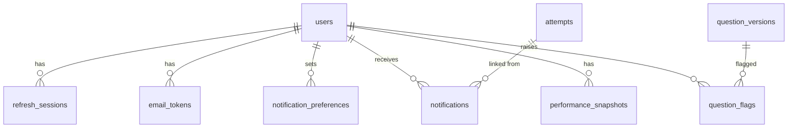
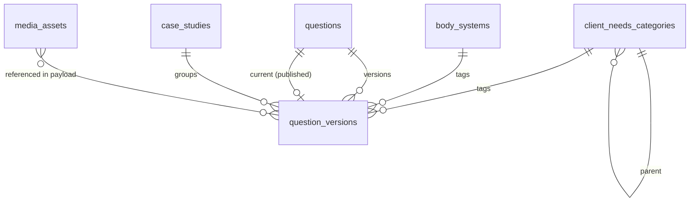
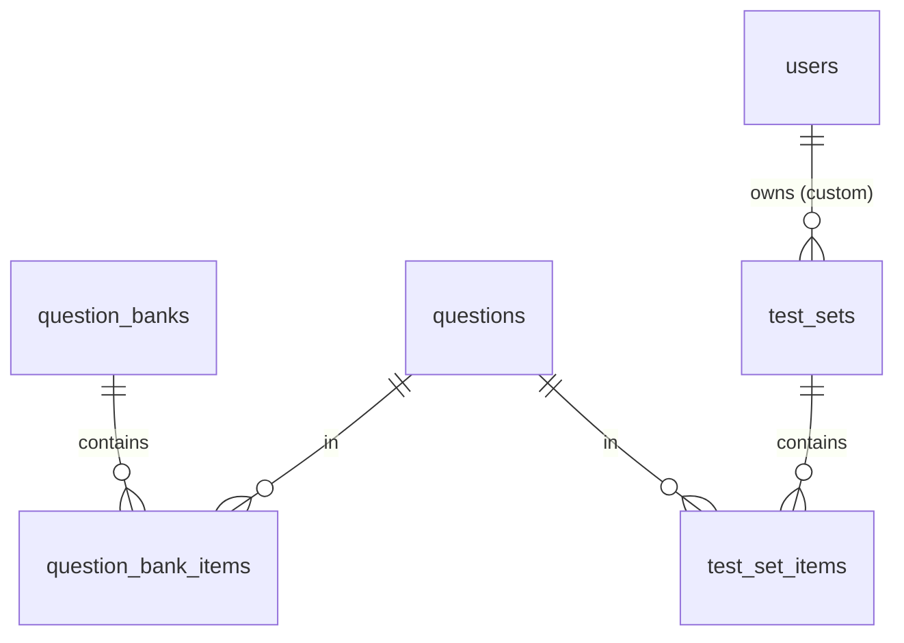
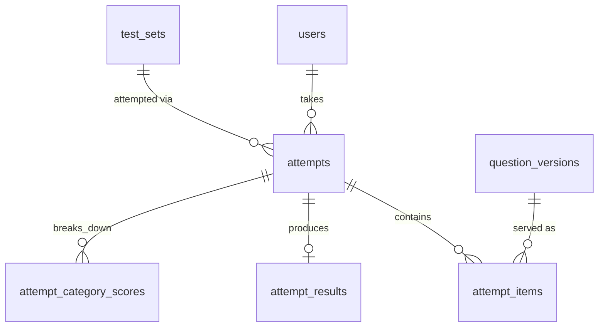

# Database Design

PostgreSQL 16. All primary keys are `uuid` (generated with `gen_random_uuid()`), except small lookup tables, which use `smallint`. All timestamps are `timestamptz` in UTC. The backend uses **EF Core 10 with the Npgsql provider**. Schema changes are EF Core migrations, shipped as a migration bundle. Hot-path statements such as autosave, grading and the builder pool query are hand-written SQL, run through EF `ExecuteSql`/`SqlQuery` or Dapper.

EF Core mapping notes:
- **Naming:** `UseSnakeCaseNamingConvention()` (EFCore.NamingConventions), so C# `PascalCase` properties map to the `snake_case` columns below.
- **Enums:** Postgres enums are registered with `NpgsqlDataSourceBuilder.MapEnum<T>()` and `modelBuilder.HasPostgresEnum<T>()`.
- **JSONB:** item payload columns (`content`, `answer_key`, `rationale`, `response`, `grade_detail`) are `JsonDocument`. Each item type deserializes them into its own records. Fixed-shape JSON (`settings`, `pause_policy`) uses `ToJson()` owned types.
- **Concurrency:** attempt writes take `SELECT … FOR UPDATE` inside an explicit transaction, not EF optimistic concurrency.
- **`citext`, `inet`, `bytea`, `text[]`** map to `string`, `IPAddress`, `byte[]` and `string[]`.
- **Postgres-only features** such as partial indexes, generated columns and CHECK constraints are declared with `HasFilter`, `HasComputedColumnSql` and `ToTable(t => t.HasCheckConstraint(…))`, or with raw SQL in a migration.

Mapping to the PRD §9 data model:

| PRD entity | Table(s) |
|---|---|
| User | `users`, `refresh_sessions`, `email_tokens` |
| QuestionBank | `question_banks`, `question_bank_items` |
| Question | `questions` + immutable `question_versions` (+ `case_studies`, `media_assets`) |
| Exam / TestSet | `test_sets`, `test_set_items` |
| Attempt | `attempts` |
| Response | `attempt_items` (one row per item in the attempt, created before it's answered) |
| PerformanceSnapshot | `performance_snapshots` (+ per-attempt `attempt_results`, `attempt_category_scores`) |
| Notebook / Flashcard | `notebook_entries`, `flashcards` (phase 2) |
| Notification | `notifications`, `notification_preferences`, `email_outbox` |

## 1. ERD (core)

The model is split into four areas so each diagram stays readable. Tables that appear in more than one diagram (`users`, `questions`, `question_versions`, `test_sets`, `attempts`) are the links between areas.

### 1.1 Identity, notifications and feedback



### 1.2 Questions and taxonomy



### 1.3 Banks and test sets



### 1.4 Attempts and results



## 2. DDL

### 2.1 Extensions and enums

```sql
CREATE EXTENSION IF NOT EXISTS pgcrypto;   -- gen_random_uuid()
CREATE EXTENSION IF NOT EXISTS citext;     -- case-insensitive email

CREATE TYPE exam_track        AS ENUM ('RN','PN');
CREATE TYPE user_role         AS ENUM ('candidate','educator','author','reviewer','admin');
CREATE TYPE plan_tier         AS ENUM ('free','premium');
CREATE TYPE email_token_purpose AS ENUM ('verify_email','reset_password','change_email');

CREATE TYPE item_type AS ENUM (
  'multiple_choice','sata','select_n',
  'matrix_mc','matrix_mr','multiple_response_grouping',
  'dropdown_cloze','dropdown_table','dropdown_rationale',
  'highlight_text','highlight_table',
  'fill_blank_calc','ordered_response',
  'drag_drop_cloze','drag_drop_rationale','bowtie','hotspot'
);
-- Trend / chart / exhibit / audio / video / graphic-option = base type + exhibits (see architecture §5.4)

CREATE TYPE difficulty_tier   AS ENUM ('easy','moderate','difficult');
CREATE TYPE cjmm_skill        AS ENUM ('recognize_cues','analyze_cues','prioritize_hypotheses',
                                       'generate_solutions','take_action','evaluate_outcomes');
CREATE TYPE version_status    AS ENUM ('draft','in_review','approved','published','superseded','rejected');
CREATE TYPE question_status   AS ENUM ('active','retired');

CREATE TYPE test_set_kind     AS ENUM ('prebuilt','custom','cat','assigned');
CREATE TYPE test_mode         AS ENUM ('practice','challenge','cat');
CREATE TYPE reveal_mode       AS ENUM ('tutor','exam');

CREATE TYPE attempt_status    AS ENUM ('in_progress','paused','submitted','abandoned');
CREATE TYPE submit_reason     AS ENUM ('user','time_expired','cat_stop');
CREATE TYPE item_state        AS ENUM ('unseen','seen','answered','locked');  -- locked = submitted (tutor) or item timer expired

CREATE TYPE notification_type AS ENUM ('result_pass','result_fail','result_ready','draft_reminder',
                                       'streak','goal_met','flag_resolved','security','system');
CREATE TYPE notification_category AS ENUM ('results','reminders','engagement','content','security');

CREATE TYPE flag_reason       AS ENUM ('rationale_unclear','incorrect_answer_key','typo','outdated_guideline',
                                       'media_problem','other');
CREATE TYPE flag_status       AS ENUM ('open','triaged','resolved','rejected');
```

### 2.2 Identity and auth

```sql
CREATE TABLE users (
  id                 uuid PRIMARY KEY DEFAULT gen_random_uuid(),
  email              citext NOT NULL UNIQUE,
  password_hash      text,                         -- NULL only for future SSO-only accounts
  email_verified_at  timestamptz,
  role               user_role   NOT NULL DEFAULT 'candidate',
  track              exam_track  NOT NULL,
  plan_tier          plan_tier   NOT NULL DEFAULT 'free',
  display_name       text,
  timezone           text        NOT NULL DEFAULT 'UTC',
  target_exam_date   date,
  locked_until       timestamptz,                  -- set after repeated failed logins
  password_changed_at timestamptz,
  created_at         timestamptz NOT NULL DEFAULT now(),
  updated_at         timestamptz NOT NULL DEFAULT now(),
  deleted_at         timestamptz
);

CREATE TABLE refresh_sessions (
  id            uuid PRIMARY KEY DEFAULT gen_random_uuid(),
  user_id       uuid NOT NULL REFERENCES users(id) ON DELETE CASCADE,
  family_id     uuid NOT NULL,                     -- rotation chain; reuse => revoke family
  token_hash    bytea NOT NULL UNIQUE,             -- sha256(token)
  user_agent    text,
  ip            inet,
  created_at    timestamptz NOT NULL DEFAULT now(),
  last_used_at  timestamptz NOT NULL DEFAULT now(),
  expires_at    timestamptz NOT NULL,              -- e.g. 30 days
  revoked_at    timestamptz,
  replaced_by   uuid REFERENCES refresh_sessions(id)
);
CREATE INDEX ON refresh_sessions (user_id) WHERE revoked_at IS NULL;
CREATE INDEX ON refresh_sessions (family_id);

CREATE TABLE email_tokens (
  id           uuid PRIMARY KEY DEFAULT gen_random_uuid(),
  user_id      uuid NOT NULL REFERENCES users(id) ON DELETE CASCADE,
  purpose      email_token_purpose NOT NULL,
  token_hash   bytea NOT NULL UNIQUE,
  new_email    citext,                             -- change_email only
  expires_at   timestamptz NOT NULL,
  consumed_at  timestamptz,
  created_at   timestamptz NOT NULL DEFAULT now()
);
CREATE INDEX ON email_tokens (user_id, purpose) WHERE consumed_at IS NULL;
```

### 2.3 Taxonomy

```sql
CREATE TABLE client_needs_categories (
  id          smallserial PRIMARY KEY,
  track       exam_track NOT NULL,
  parent_id   smallint REFERENCES client_needs_categories(id),
  code        text NOT NULL,                       -- e.g. 'SECE', 'SECE.MOC'
  name        text NOT NULL,                       -- e.g. 'Management of Care'
  weight_min  numeric(5,2),                        -- 15.00
  weight_max  numeric(5,2),                        -- 21.00
  sort_order  smallint NOT NULL DEFAULT 0,
  UNIQUE (track, code)
);
-- Leaf rows are the "subcategory" (or the category itself when it has no subcategories,
-- e.g. Psychosocial Integrity). Questions are always tagged to a leaf.

CREATE TABLE body_systems (
  id    smallserial PRIMARY KEY,
  slug  text NOT NULL UNIQUE,                      -- 'cardiovascular', 'pharmacology', ...
  name  text NOT NULL
);
```

Seed data for RN follows PRD §2.4. The PN test plan is seeded separately because its categories and weights differ.

### 2.4 Content

```sql
CREATE TABLE media_assets (
  id            uuid PRIMARY KEY DEFAULT gen_random_uuid(),
  kind          text NOT NULL CHECK (kind IN ('image','audio','video')),
  storage_key   text NOT NULL UNIQUE,
  mime_type     text NOT NULL,
  bytes         bigint NOT NULL,
  width         int, height int, duration_ms int,
  alt_text      text,                              -- required for images before publish
  captions_key  text,                              -- WebVTT, required for audio/video before publish
  transcript_key text,                             -- plain text, required for audio/video before publish (F11)
  created_by    uuid REFERENCES users(id),
  created_at    timestamptz NOT NULL DEFAULT now()
);

CREATE TABLE case_studies (                        -- NGN unfolding case (usually 6 items)
  id          uuid PRIMARY KEY DEFAULT gen_random_uuid(),
  track       exam_track NOT NULL,
  title       text NOT NULL,
  scenario    jsonb NOT NULL,                      -- tabs: nurses' notes, vitals, labs, orders, history
  created_at  timestamptz NOT NULL DEFAULT now()
);

CREATE TABLE questions (                           -- stable identity of an item across edits
  id                  uuid PRIMARY KEY DEFAULT gen_random_uuid(),
  track               exam_track NOT NULL,
  status              question_status NOT NULL DEFAULT 'active',
  current_version_id  uuid,                        -- FK added below; the published version
  access_tier         plan_tier NOT NULL DEFAULT 'free',
  created_by          uuid REFERENCES users(id),
  created_at          timestamptz NOT NULL DEFAULT now(),
  retired_at          timestamptz
);

CREATE TABLE question_versions (                   -- immutable once status leaves 'draft'
  id                     uuid PRIMARY KEY DEFAULT gen_random_uuid(),
  question_id            uuid NOT NULL REFERENCES questions(id),
  version                int  NOT NULL,
  status                 version_status NOT NULL DEFAULT 'draft',
  item_type              item_type NOT NULL,
  stem                   text NOT NULL,            -- sanitized Markdown
  content                jsonb NOT NULL,           -- render payload (options, grid, blanks...) — safe to send
  answer_key             jsonb NOT NULL,           -- NEVER sent to candidates before reveal
  rationale              jsonb NOT NULL,           -- per-option + correct explanation; hidden until reveal
  educational_objective  text NOT NULL,
  exhibits               jsonb NOT NULL DEFAULT '[]',  -- charts, flowsheets (trend), media refs
  client_needs_id        smallint NOT NULL REFERENCES client_needs_categories(id),
  body_system_id         smallint NOT NULL REFERENCES body_systems(id),
  cjmm_skill             cjmm_skill,
  difficulty             difficulty_tier NOT NULL,
  irt_a                  numeric(6,3),             -- discrimination (future)
  irt_b                  numeric(6,3),             -- difficulty (CAT)
  irt_c                  numeric(6,3),             -- guessing (future)
  time_allotment_sec     int NOT NULL DEFAULT 120 CHECK (time_allotment_sec > 0),
  max_points             smallint NOT NULL CHECK (max_points > 0),  -- derived from key at save time
  case_study_id          uuid REFERENCES case_studies(id),
  case_position          smallint,                 -- 1..6 within case study
  author_id              uuid NOT NULL REFERENCES users(id),
  reviewer_id            uuid REFERENCES users(id),
  review_notes           text,
  reviewed_at            timestamptz,
  published_at           timestamptz,
  created_at             timestamptz NOT NULL DEFAULT now(),
  UNIQUE (question_id, version),
  CHECK ((case_study_id IS NULL) = (case_position IS NULL))
);
ALTER TABLE questions
  ADD CONSTRAINT questions_current_version_fk
  FOREIGN KEY (current_version_id) REFERENCES question_versions(id);

-- Builder pool query: filter by tags on published current versions
CREATE INDEX qv_filter_idx ON question_versions (client_needs_id, body_system_id, item_type, difficulty)
  WHERE status = 'published';
CREATE INDEX qv_question_idx ON question_versions (question_id, version DESC);
CREATE INDEX qv_review_queue_idx ON question_versions (status, created_at) WHERE status = 'in_review';

CREATE TABLE question_banks (
  id           uuid PRIMARY KEY DEFAULT gen_random_uuid(),
  track        exam_track NOT NULL,
  name         text NOT NULL,
  description  text,
  access_tier  plan_tier NOT NULL DEFAULT 'free',
  is_published boolean NOT NULL DEFAULT false,
  created_at   timestamptz NOT NULL DEFAULT now()
);
CREATE TABLE question_bank_items (
  bank_id      uuid REFERENCES question_banks(id) ON DELETE CASCADE,
  question_id  uuid REFERENCES questions(id),
  PRIMARY KEY (bank_id, question_id)
);
```

**Rules enforced in the application:**
- A version's `content`, `answer_key` and `rationale` are validated against the item type's schema on every save. Every option ID in `content` must have an entry in `rationale.perOption` (PRD §5.1: a "why" for every option).
- Publishing a version sets the previous published version to `superseded` and updates `questions.current_version_id` in one transaction.
- Only `reviewer` and `admin` roles can move a version `in_review → approved`. Authors can't approve their own versions (`reviewer_id <> author_id`).

### 2.5 Test sets

```sql
CREATE TABLE test_sets (
  id                 uuid PRIMARY KEY DEFAULT gen_random_uuid(),
  track              exam_track NOT NULL,
  kind               test_set_kind NOT NULL,
  owner_user_id      uuid REFERENCES users(id),    -- custom sets only
  title              text NOT NULL,
  description        text,
  mode               test_mode   NOT NULL DEFAULT 'practice',
  reveal_mode        reveal_mode NOT NULL DEFAULT 'tutor',
  timed              boolean NOT NULL DEFAULT false,
  per_question_sec   int,                          -- NULL = no per-item timer
  time_budget_sec    int,                          -- NULL = no exam timer
  pass_threshold     numeric(5,4),                 -- 0.6500; NULL = no pass/fail estimate
  pause_policy       jsonb NOT NULL DEFAULT '{"maxPauses":null,"maxPauseSec":null}',
  allow_back_nav     boolean NOT NULL DEFAULT true,
  is_sample          boolean NOT NULL DEFAULT false,  -- startable by unverified users
  access_tier        plan_tier NOT NULL DEFAULT 'free',
  is_published       boolean NOT NULL DEFAULT false,
  generator_criteria jsonb,                        -- custom builder filters (for "retake similar")
  cat_config         jsonb,                        -- {minItems, maxItems, passingTheta} for CAT
  question_count     int NOT NULL,
  created_at         timestamptz NOT NULL DEFAULT now(),
  CHECK (kind <> 'custom' OR owner_user_id IS NOT NULL),
  CHECK (NOT timed OR per_question_sec IS NOT NULL OR time_budget_sec IS NOT NULL)
);
CREATE INDEX ON test_sets (track, kind) WHERE is_published;
CREATE INDEX ON test_sets (owner_user_id) WHERE kind = 'custom';

CREATE TABLE test_set_items (
  test_set_id  uuid REFERENCES test_sets(id) ON DELETE CASCADE,
  position     int  NOT NULL,
  question_id  uuid NOT NULL REFERENCES questions(id),  -- resolved to current version at attempt start
  PRIMARY KEY (test_set_id, position),
  UNIQUE (test_set_id, question_id)
);
```

### 2.6 Attempts (session engine)

```sql
CREATE TABLE attempts (
  id                  uuid PRIMARY KEY DEFAULT gen_random_uuid(),
  user_id             uuid NOT NULL REFERENCES users(id),
  test_set_id         uuid NOT NULL REFERENCES test_sets(id),
  track               exam_track NOT NULL,
  status              attempt_status NOT NULL DEFAULT 'in_progress',
  settings            jsonb NOT NULL,       -- snapshot of mode/reveal/timing/pause policy/threshold at start
  total_items         int NOT NULL,
  current_position    int NOT NULL DEFAULT 1,

  -- exam-level timer (architecture §5.1)
  exam_deadline_at    timestamptz,          -- non-NULL only while running and timed
  exam_remaining_ms   bigint,               -- authoritative while paused
  timer_epoch         int NOT NULL DEFAULT 0,  -- bumps on pause/resume; invalidates delayed expiry jobs

  -- pause
  pauses_used         smallint NOT NULL DEFAULT 0,
  pause_started_at    timestamptz,
  pause_reason        text CHECK (pause_reason IN ('break','save_exit')),
  total_paused_ms     bigint NOT NULL DEFAULT 0,

  -- device lease (architecture §5.2)
  active_client_id    text,
  lease_acquired_at   timestamptz,

  cat_state           jsonb,                -- phase 2: {theta, se, contentCounts}

  started_at          timestamptz NOT NULL DEFAULT now(),
  last_activity_at    timestamptz NOT NULL DEFAULT now(),
  submitted_at        timestamptz,
  submit_reason       submit_reason,
  CHECK (status <> 'submitted' OR submitted_at IS NOT NULL),
  CHECK (status <> 'paused' OR exam_deadline_at IS NULL)
);
CREATE INDEX attempts_drafts_idx   ON attempts (user_id, last_activity_at DESC)
  WHERE status IN ('in_progress','paused');
CREATE INDEX attempts_history_idx  ON attempts (user_id, submitted_at DESC) WHERE status = 'submitted';
CREATE INDEX attempts_expiry_idx   ON attempts (exam_deadline_at) WHERE status = 'in_progress';  -- sweeper

CREATE TABLE attempt_items (
  attempt_id           uuid NOT NULL REFERENCES attempts(id) ON DELETE CASCADE,
  position             int  NOT NULL,
  question_version_id  uuid NOT NULL REFERENCES question_versions(id),
  state                item_state NOT NULL DEFAULT 'unseen',
  response             jsonb,               -- validated against item type's response schema
  client_seq           int NOT NULL DEFAULT 0,
  flagged              boolean NOT NULL DEFAULT false,   -- "mark for review" (not a content flag)
  struck_options       jsonb NOT NULL DEFAULT '[]',      -- strike-through tool (phase 3 UI; stored now)

  -- time tracking (server-derived)
  entered_at           timestamptz,         -- set when navigated to; cleared on leave/pause
  time_spent_ms        bigint NOT NULL DEFAULT 0,
  item_deadline_at     timestamptz,
  item_remaining_ms    int,

  -- grading
  points_earned        numeric(6,2),
  max_points           smallint,
  is_correct           boolean,             -- points_earned = max_points
  grade_detail         jsonb,               -- per-target +1/-1/0 (partial-credit visibility, PRD §5.6)
  graded_at            timestamptz,
  locked_at            timestamptz,
  answered_at          timestamptz,
  PRIMARY KEY (attempt_id, position)
);
```

**Invariants:**
- Every mutation of an attempt or its items first runs `SELECT … FROM attempts WHERE id=$1 FOR UPDATE`. That serialises writes per attempt, which is cheap because only one device holds the lease.
- An `attempt_items` row with `state='locked'` is never written again.
- `question_version_id` is fixed when the item is created, so a later edit to the question never changes this attempt.

### 2.7 Results and analytics

```sql
CREATE TABLE attempt_results (
  attempt_id        uuid PRIMARY KEY REFERENCES attempts(id) ON DELETE CASCADE,
  points_earned     numeric(8,2) NOT NULL,
  max_points        numeric(8,2) NOT NULL,
  score_pct         numeric(5,4) NOT NULL,
  items_correct     int NOT NULL,
  items_answered    int NOT NULL,
  items_total       int NOT NULL,
  total_time_ms     bigint NOT NULL,
  avg_time_ms       int NOT NULL,
  pass_threshold    numeric(5,4),
  passed            boolean,                       -- NULL when no threshold
  readiness_label   text,                          -- 'likely_ready' | 'needs_more_practice'
  cat_theta         numeric(6,3), cat_se numeric(6,3),
  graded_at         timestamptz NOT NULL DEFAULT now()
);

CREATE TABLE attempt_category_scores (
  attempt_id     uuid REFERENCES attempts(id) ON DELETE CASCADE,
  dimension      text NOT NULL CHECK (dimension IN ('client_needs','client_needs_parent','body_system','item_type','cjmm_skill','difficulty')),
  dimension_key  text NOT NULL,                    -- category code, system slug, item_type...
  items          int NOT NULL,
  items_correct  int NOT NULL,
  points_earned  numeric(8,2) NOT NULL,
  max_points     numeric(8,2) NOT NULL,
  time_ms        bigint NOT NULL,
  PRIMARY KEY (attempt_id, dimension, dimension_key)
);

CREATE TABLE performance_snapshots (               -- denormalized, rebuilt incrementally by worker
  user_id         uuid REFERENCES users(id) ON DELETE CASCADE,
  track           exam_track NOT NULL,
  dimension       text NOT NULL,
  dimension_key   text NOT NULL,
  items_answered  int NOT NULL,
  items_correct   int NOT NULL,
  points_earned   numeric(10,2) NOT NULL,
  max_points      numeric(10,2) NOT NULL,
  accuracy        numeric(5,4) GENERATED ALWAYS AS
                    (CASE WHEN max_points > 0 THEN points_earned / max_points ELSE 0 END) STORED,
  avg_time_ms     int NOT NULL,
  attempts_count  int NOT NULL,
  last_attempt_id uuid,                            -- idempotency guard for incremental updates
  updated_at      timestamptz NOT NULL DEFAULT now(),
  PRIMARY KEY (user_id, track, dimension, dimension_key)
);

CREATE TABLE user_question_history (               -- powers "unused only" / "incorrect only" builder filters
  user_id          uuid REFERENCES users(id) ON DELETE CASCADE,
  question_id      uuid REFERENCES questions(id),
  times_seen       int NOT NULL DEFAULT 0,
  last_correct     boolean,
  last_seen_at     timestamptz NOT NULL,
  PRIMARY KEY (user_id, question_id)
);
```

Trend charts (PRD §5.6 "historical trend") are read from `attempt_category_scores` joined to `attempts.submitted_at` and grouped by week. That's indexed on `(user_id, submitted_at)`, so no extra table is needed.

### 2.8 Notifications

```sql
CREATE TABLE notifications (
  id                  uuid PRIMARY KEY DEFAULT gen_random_uuid(),
  user_id             uuid NOT NULL REFERENCES users(id) ON DELETE CASCADE,
  type                notification_type NOT NULL,
  category            notification_category NOT NULL,
  title               text NOT NULL,
  body                text NOT NULL,
  data                jsonb NOT NULL DEFAULT '{}',   -- {scorePct, weakestCategories[], deepLink}
  related_attempt_id  uuid REFERENCES attempts(id) ON DELETE SET NULL,
  channels            text[] NOT NULL,               -- {'in_app'} | {'in_app','email'}
  read_at             timestamptz,
  created_at          timestamptz NOT NULL DEFAULT now()
);
CREATE INDEX notif_feed_idx   ON notifications (user_id, created_at DESC);
CREATE INDEX notif_unread_idx ON notifications (user_id) WHERE read_at IS NULL;
CREATE UNIQUE INDEX notif_result_once ON notifications (related_attempt_id)
  WHERE type IN ('result_pass','result_fail','result_ready');   -- grading retry can't double-notify

CREATE TABLE notification_preferences (
  user_id   uuid REFERENCES users(id) ON DELETE CASCADE,
  category  notification_category NOT NULL,
  in_app    boolean NOT NULL DEFAULT true,
  email     boolean NOT NULL,
  PRIMARY KEY (user_id, category)
);
-- Defaults are applied at signup: results=email on, security=email on (in-app forced on), others email off.

CREATE TABLE email_outbox (
  id            uuid PRIMARY KEY DEFAULT gen_random_uuid(),
  user_id       uuid REFERENCES users(id) ON DELETE CASCADE,
  to_email      citext NOT NULL,
  template      text NOT NULL,                     -- 'verify_email','reset_password','result_pass',...
  payload       jsonb NOT NULL,
  status        text NOT NULL DEFAULT 'pending' CHECK (status IN ('pending','sending','sent','failed')),
  attempts      smallint NOT NULL DEFAULT 0,
  send_after    timestamptz NOT NULL DEFAULT now(),
  sent_at       timestamptz,
  provider_id   text,
  last_error    text,
  created_at    timestamptz NOT NULL DEFAULT now()
);
CREATE INDEX outbox_pending_idx ON email_outbox (send_after) WHERE status = 'pending';
```

### 2.9 Content feedback and audit

```sql
CREATE TABLE question_flags (
  id                   uuid PRIMARY KEY DEFAULT gen_random_uuid(),
  user_id              uuid NOT NULL REFERENCES users(id),
  question_version_id  uuid NOT NULL REFERENCES question_versions(id),
  attempt_id           uuid REFERENCES attempts(id) ON DELETE SET NULL,
  reason               flag_reason NOT NULL,
  comment              text CHECK (char_length(comment) <= 2000),
  status               flag_status NOT NULL DEFAULT 'open',
  assignee_id          uuid REFERENCES users(id),
  resolution_note      text,                       -- shown to the candidate in flag_resolved notification
  resolved_by          uuid REFERENCES users(id),
  resolved_at          timestamptz,
  created_at           timestamptz NOT NULL DEFAULT now(),
  UNIQUE (user_id, question_version_id, reason)
);
CREATE INDEX flags_queue_idx ON question_flags (status, created_at) WHERE status IN ('open','triaged');

CREATE TABLE audit_events (
  id          bigserial PRIMARY KEY,
  actor_id    uuid REFERENCES users(id),
  action      text NOT NULL,                       -- 'question.publish','flag.resolve','auth.login_failed',...
  entity_type text, entity_id text,
  metadata    jsonb NOT NULL DEFAULT '{}',
  ip          inet,
  created_at  timestamptz NOT NULL DEFAULT now()
);
CREATE INDEX ON audit_events (entity_type, entity_id);
```

## 3. Phase 2 and 3 tables (outline)

These don't affect the MVP schema. They only add tables or nullable columns.

| Table | Key columns | Feature |
|---|---|---|
| `notebook_entries` | id, user_id, question_id?, attempt_id?, note_md, tags[], created_at | Digital notebook (§6.1) |
| `flashcards` | id, user_id, source (`missed_question`/`rationale`/`manual`), front, back, question_id?, ease (2.5), interval_days, repetitions, due_at | SM-2 spaced repetition |
| `study_plans` / `study_plan_days` | user_id, target_date, daily_goal; day, planned_count, focus_category_ids[] | Study planner |
| `user_daily_activity` | user_id, day, items_answered | Streaks and goals (computed from attempt_items, upserted at grading) |
| `achievements`, `user_achievements` | code, name, criteria; user_id, code, earned_at | Achievements |
| `leaderboard_entries` | test_set_id, user_id, display_name, score_pct, time_ms | Opt-in challenge leaderboard |
| `subscriptions` | user_id, provider, provider_customer_id, status, current_period_end | Paid tier |
| `organizations`, `cohorts`, `cohort_members`, `assignments` | org_id; cohort_id, user_id, role; cohort_id, test_set_id, due_at | Educator console (phase 3) |
| `user_identities` | user_id, provider, subject | Google / Apple SSO |

## 4. Data lifecycle and retention

- **Attempts and results:** kept for the life of the account. Abandoned drafts are hard-deleted after 90 days.
- **Custom test sets:** deleted when they have no attempts and are more than 30 days old.
- **`refresh_sessions` and `email_tokens`:** purged 30 days after expiry.
- **`email_outbox`:** sent rows purged after 30 days.
- **Account deletion:** PII in `users` is scrubbed (email → `deleted+{id}@invalid`), sessions are deleted, and attempts are kept anonymised for item statistics such as IRT calibration.
- **Backups:** continuous WAL archiving / PITR (14 days) plus a daily snapshot copied to a second region.

## 5. Sizing estimate (year 1, for capacity planning)

Assumptions: 50k users, 10k active per month, about 300 items each per month.
- `attempt_items` grows by about 3M rows a month, roughly 1.5 KB per row → about 55 GB per year. Postgres handles this comfortably. Hash-partition `attempt_items` by `attempt_id` only if it goes past about 500M rows.
- Question content: about 10k versions × about 8 KB → under 100 MB.
